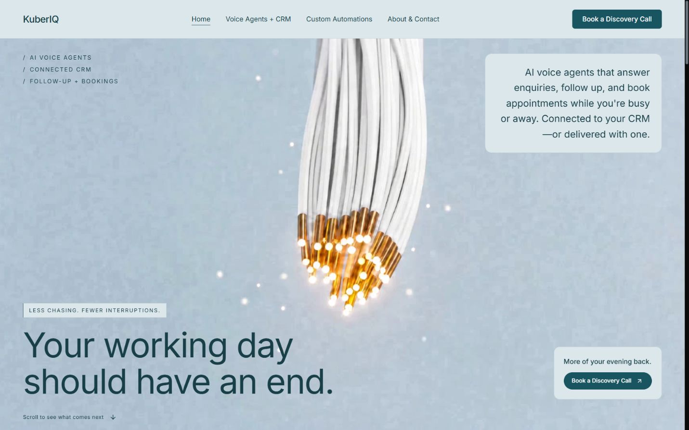
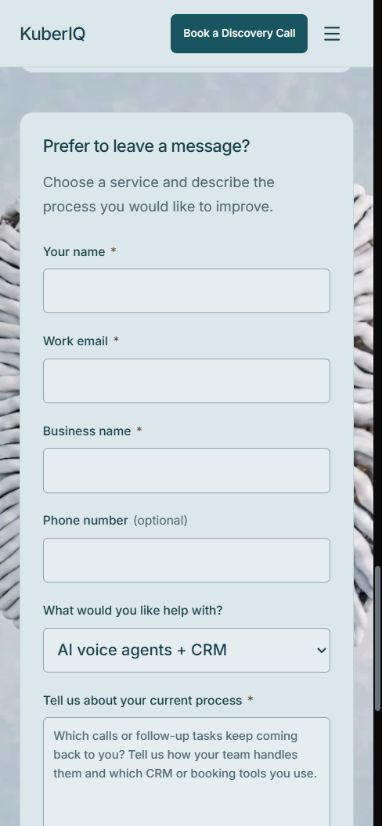
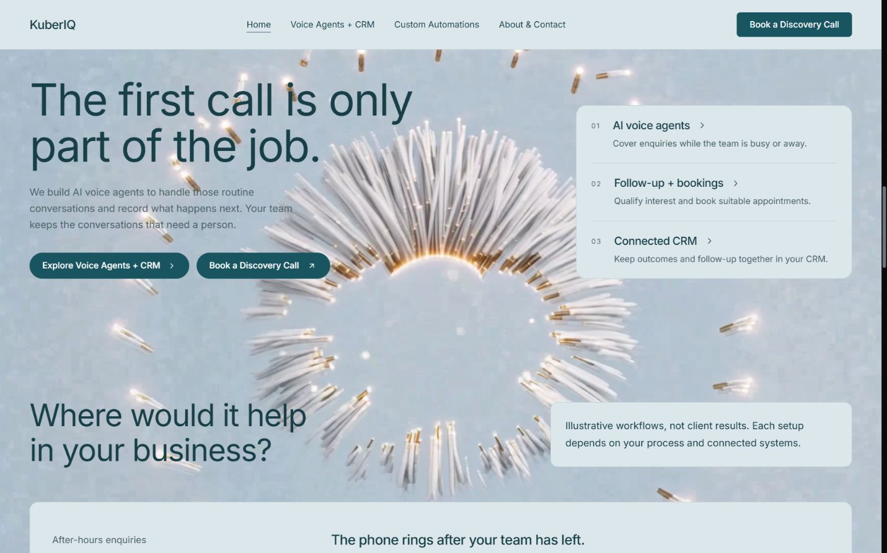

# KuberIQ

### Your working day should have an end.

A cinematic, responsive website for an AI voice-agent and CRM service. Built with React, TypeScript and Vite, with a reversible scroll-driven animation and clear, practical service information.



**[Live website](https://www.kuberiq.si/) · [Project brief](docs/PROJECT-BRIEF.md) · [Architecture](docs/ARCHITECTURE.md) · [Security review](docs/SECURITY-REVIEW.md)**

## The project

Service businesses spend time chasing callbacks, checking bookings and transferring updates between tools. KuberIQ explains how voice agents and connected workflows could help, while making human handover and project scope clear.

This repository contains the website experience. It does not contain an operational voice-agent platform, CRM backend or customer database.

## Experience highlights

- **Scroll-directed storytelling.** A fixed cinematic scene follows progress through the document and reverses when scrolling back.
- **Progressive image quality.** A progressively loaded preview keeps scrolling responsive; a bounded cache supplies native 1080p source detail during movement, sized to the display.
- **Readable surfaces.** Pale blue-grey panels and dark teal copy separate content from the moving artwork.
- **Responsive navigation.** Dedicated service pages and layouts for desktop and mobile.
- **Accessible fallbacks.** Keyboard navigation, focus styles, semantic content and a static poster for reduced-motion preferences.
- **Clear next steps.** Every booking button uses the approved Calendly link. An optional calendar loads on request; direct email links open the visitor's email app.
- **Concrete, honest examples.** An illustrative conversation and handover explain requested versus confirmed actions, alongside the vision, delivery process, costs, and customer controls.

<details>
<summary>Mobile homepage</summary>



</details>

## A clearer service story

The homepage shows an illustrative conversation beside its handover record, followed by how we work, what a first project includes, CRM options and the vision. Requested actions are distinguished from confirmed bookings.



## Pages

| Route | Purpose |
| --- | --- |
| `/` | Introduce the offer, illustrate use cases and guide visitors to a service |
| `/voice-agents.html` | Explain conversations, bookings, follow-up and CRM handover |
| `/automations.html` | Explain workflow automation and connected website services |
| `/contact.html` | Vision, delivery process, Calendly scheduling, and both business email contacts |
| `/privacy.html` | Explain email, scheduling, and browsing data flows |
| `/terms.html` | Explain website examples and how project scope and costs are agreed |

## Run locally

Use Node.js 24 and npm. No API key is required to run the website.

```sh
npm ci
npm run dev -- --port 5200
```

Open **http://127.0.0.1:5200/**.

```sh
npm test          # Motion, interpolation and cache behaviour
npm run test:security # Build and check real preview response headers
npm run build    # Type checking and production bundle
npm run preview  # Local preview of the built files
```

`npm run preview` is for local validation, not a production server. Deploy only the generated `dist/` directory to a suitable static host after configuring its security headers and live integrations.

## Security configuration

Direct dependencies are pinned to the audited lockfile versions; use `npm ci` for repeatable installs. Extensionless service routes (`/voice-agents`, `/automations`, `/contact`) and their trailing-slash forms select the same content as the canonical `.html` links when the host serves the app for those paths.

`security-headers.ts` supplies CSP, framing restrictions, MIME-sniffing protection, referrer policy and permissions policy to both local servers. Production scripts are restricted to the same origin. Inline styles remain allowed for the existing React animation styles, and Google Fonts remain allowed to preserve typography. Only development permits Vite's inline bootstrap and loopback WebSocket connection. Only `https://calendly.com` is allowed as a frame source. There is no form submission endpoint; CSP continues to block form submissions. The optional scheduling iframe is absent until requested and removed when closed.

Each production build emits `dist/_headers` from the same configuration. Hosts supporting that manifest format can apply it directly; other hosts (including any selected Wix deployment) must have the equivalent response headers configured through their supported hosting controls. Uploading a file does not establish that a host enforces it. Verify actual response headers after deployment. Do not substitute an HTML meta tag for framing protection. HTTPS/HSTS remains a host-level launch check; no production account or DNS is changed by this repository.

Configuration references: [Vite preview headers](https://vite.dev/config/preview-options#preview-headers), [Vite development headers](https://vite.dev/config/server-options#server-headers), and [CSP inline style handling](https://developer.mozilla.org/en-US/docs/Web/HTTP/Reference/Headers/Content-Security-Policy/style-src-attr).

## Stack and structure

| Layer | Implementation |
| --- | --- |
| UI | React + TypeScript |
| Build | Vite, multi-page HTML entries |
| Styling | CSS with shared brand tokens |
| Motion | Lenis, Canvas 2D, WebP frame sequences |
| Icons | Lucide React |
| Tests | Node.js test runner |

```text
src/                 Page components, styling and animation renderer
public/              Poster, video, frame sequences and attribution
tests/              Motion and frame-cache regression tests
docs/               Public project brief, architecture and screenshots
```

## Status and boundaries

This is a working frontend with the owner-approved Calendly destination and email enquiry links. Website privacy and service information describe these implemented flows. The six pages, current animation assets, and Calendly embed were verified on Wix on 25 October 2026. The production header gap is documented in [the security review](docs/SECURITY-REVIEW.md). The sitemap uses `/sitemap-index.xml` because Wix intercepts the standard path; crawler discovery and search indexing remain unverified. Project-specific legal agreements remain a separate acceptance task. Email delivery has not been tested by sending messages, and no meetings are booked as part of frontend checks. Example workflows are illustrative; there are no claimed client results or guaranteed business outcomes.

Security coverage and limitations are recorded in [the review notes](docs/SECURITY-REVIEW.md). A passing build or an empty scanner report does not certify an application as vulnerability-free.

## Attribution

See [THIRD_PARTY_NOTICES.md](THIRD_PARTY_NOTICES.md) for component and dependency attribution. Visual references guided the design; the implementation retains KuberIQ's identity and service copy. Brand and media assets are not offered under a blanket open-source licence. Review their permissions before reusing them.

